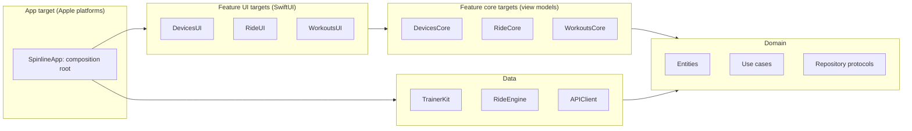

# Spinline

[](https://github.com/adam-bouafia/spinline/actions/workflows/ci.yml)

-lightgrey)
[](LICENSE)

Spinline is an indoor cycling app for smart trainers, written in Swift and SwiftUI. It connects to a trainer over Bluetooth, runs structured workouts in ERG mode, plays a route video whose speed follows the rider's effort, and lets several riders share a route.

Spinline is built on public Bluetooth SIG specifications (Fitness Machine Service, Heart Rate Service) and its own content. It is an independent personal project and is not affiliated with or endorsed by any trainer manufacturer or app maker.

## Contents

- [Status](#status)
- [Features](#features)
- [Architecture](#architecture)
- [Repository layout](#repository-layout)
- [Getting started](#getting-started)
- [Bluetooth protocol](#bluetooth-protocol)
- [Testing](#testing)
- [Continuous integration](#continuous-integration)
- [Branching and releases](#branching-and-releases)
- [Non-goals](#non-goals)
- [License](#license)

## Status

Early development. The protocol, physics and workout layers come first, because they are pure Swift and are tested on Linux and macOS on every push. The iOS app is built on top of them.

| Milestone | Scope | State |
|---|---|---|
| M0 | Repository, packages, toolchain, CI | done |
| M1 | TrainerKit: FTMS and heart-rate codecs | done |
| M2 | RideEngine: ride physics, workouts, video rate | in progress |
| M3 | Virtual trainer and a command-line ride | planned |
| M4 | SwiftUI app built and tested in CI (iOS simulator) | planned |
| M5 | CoreBluetooth adapter for real trainers | planned |
| M6 | Route video synced to the rider's speed | planned |
| M7 | Backend from an OpenAPI spec, group ride | planned |
| M8 | Voice cues, ride export, Mac Catalyst, release 0.1.0 | planned |

## Features

- **Devices.** Discover and connect a smart trainer that implements the Fitness Machine Service (FTMS) and a heart-rate strap. Live power, cadence, speed and heart rate.
- **Virtual trainer.** A software trainer that produces real FTMS packets and accepts control commands, so the app, the tests and CI run without hardware.
- **ERG and simulation.** Hold a target power whatever the cadence, or ride a gradient that the trainer turns into resistance.
- **Workouts.** Structured intervals with targets as a share of FTP, a timeline, and voice cues.
- **Route video.** A recorded ride whose playback rate follows the rider's virtual speed, computed from power, weight and the gradient of the route. The gradient is sent to the trainer.
- **Group ride.** Riders on the same route see each other on an elevation profile, over WebSockets.
- **Backend.** Routes, workouts and ride uploads behind an OpenAPI specification; client and server code are generated from the same file.
- **Export.** Rides saved as FIT files for upload to training platforms.
- **Mac.** The same app on macOS through Mac Catalyst.

## Architecture

Clean Architecture with MVVM, split into feature modules. Each module is a local Swift package.



Rules that keep the layers honest:

- **Domain** holds entities (`TrainerSample`, `Workout`, `Route`), use cases and repository protocols such as `TrainerConnection`. It knows nothing about Bluetooth, SwiftUI or the network.
- **Data** implements the Domain protocols. `TrainerKit` speaks Bluetooth, `RideEngine` does physics and timing, `APIClient` talks to the backend.
- **Feature core** targets hold one `@Observable` view model per screen. They import Domain and Observation, never SwiftUI, so they build and test on Linux.
- **Feature UI** targets hold thin SwiftUI views: layout and bindings only.
- **The app target** is the composition root. It chooses the real or the virtual trainer and injects dependencies through initialisers.

## Repository layout

```
Packages/
  Domain/        entities, use cases, repository protocols
  TrainerKit/    FTMS and heart-rate codecs, virtual trainer, CoreBluetooth adapter
  RideEngine/    ride physics, workout engine, video rate mapping
tools/
  dev.sh         build, test and lint wrapper used locally and in CI
.github/
  workflows/     CI on Linux and macOS
```

Feature packages, the app target, the server and the OpenAPI specification are added as the milestones above land.

## Getting started

Requirements:

- Swift 6.0 or newer. Developed with Swift 6.3 on Linux and Xcode on macOS.
- For the iOS app (from M4): Xcode with the iOS 17 SDK or newer, and [XcodeGen](https://github.com/yonaskolb/XcodeGen).

Clone and run the tests:

```bash
git clone https://github.com/adam-bouafia/spinline.git
cd spinline
tools/dev.sh test             # every package
tools/dev.sh test TrainerKit  # one package
tools/dev.sh lint             # swift format, strict
```

Each package also works with plain SwiftPM:

```bash
swift test --package-path Packages/TrainerKit
```

`tools/dev.sh` picks a known toolchain and, on Linux workstations, runs builds in a memory-capped systemd scope at low priority. Set `SPINLINE_TOOLCHAIN` to use another toolchain; run `tools/dev.sh` without arguments for all options.

## Bluetooth protocol

Spinline talks to trainers through the Fitness Machine Service as defined in the Bluetooth SIG specification FTMS v1.0 and the GATT Specification Supplement.

| Service or characteristic | UUID | Use |
|---|---|---|
| Fitness Machine Service | `0x1826` | trainer discovery |
| Fitness Machine Feature | `0x2ACC` | read: what the trainer measures and accepts |
| Indoor Bike Data | `0x2AD2` | notify: speed, cadence, power, about once a second |
| Supported Power Range | `0x2AD8` | read: ERG limits |
| Fitness Machine Control Point | `0x2AD9` | write and indicate: request control, target power, simulation |
| Fitness Machine Status | `0x2ADA` | notify: changes made by the trainer or the rider |
| Heart Rate Service | `0x180D` | heart-rate straps |
| Heart Rate Measurement | `0x2A37` | notify: heart rate and RR intervals |

All values are little-endian. Indoor Bike Data starts with a 16-bit flags field; each set flag adds a field in a fixed order. The codecs are pure functions over byte arrays and are tested against byte fixtures, so the protocol is verified without a radio.

TrainerKit implements:

| Type | Characteristic | Direction |
|---|---|---|
| `IndoorBikeData` | Indoor Bike Data | decode and encode, all 13 fields |
| `ControlPointCommand` | Fitness Machine Control Point | encode (client) and decode (virtual trainer) |
| `ControlPointResponse` | Fitness Machine Control Point | decode and encode |
| `FitnessMachineFeature` | Fitness Machine Feature | decode and encode |
| `FitnessMachineStatus` | Fitness Machine Status | decode and encode |
| `SupportedPowerRange` | Supported Power Range | decode and encode, nearest valid ERG target |
| `HeartRateMeasurement` | Heart Rate Measurement | decode and encode, 8 and 16-bit values, RR intervals |

Points where the specifications disagree, and what the code does:

- **Resistance Level in Indoor Bike Data.** FTMS v1.0 refers to a 2-byte `sint16`; the GATT Specification Supplement of 2026 lists a 1-byte `uint8`. All other fields have fixed sizes, so the packet length tells the two apart, and the decoder accepts both.
- **Instantaneous Cadence flag.** Table 4.10 of FTMS v1.0 prints bit 2 inverted; the GATT Specification Supplement says bit 2 set means cadence is present, which is what the code follows.
- **Padding.** Bytes after the last announced field are ignored, because some implementations append them. Control point writes, decoded by the virtual trainer, are strict: a wrong parameter size is an error.

Decoders never crash on bad input: a test feeds every decoder 20,000 random packets from a seeded generator.

## Testing

- Swift Testing (`@Test`, `#expect`, parameterised arguments) in every package.
- Codecs are tested with byte fixtures worked out by hand from the specification tables, encode-decode round trips, and malformed packets that must throw.
- Random packets from a seeded generator check that no decoder can crash on radio input.
- View models are tested on Linux against the virtual trainer (from M4).
- UI tests run on an iOS simulator in CI and record screenshots and a short video (from M4).

## Continuous integration

GitHub Actions runs on every push to `develop` and `main` and on every pull request:

| Job | Runner | Steps |
|---|---|---|
| Linux | `swift:6.3-noble` container | `swift format lint --strict`, test every package |
| macOS | `macos-15` with Xcode | test every package |

A Jenkinsfile with the same stages follows in M8.

## Branching and releases

The repository follows GitFlow:

- `develop` is the default branch and always builds.
- Work happens on `feature/*` branches and reaches `develop` through pull requests with green CI.
- Releases are cut on `release/x.y.z`, merged into `main` and tagged `vx.y.z`.
- Urgent fixes go on `hotfix/*` from `main`.

Commit messages follow [Conventional Commits](https://www.conventionalcommits.org/).

## Non-goals

- App Store distribution, accounts and payments.
- ANT+, which iOS devices do not support without extra hardware.
- Proprietary trainer protocols or content from other apps.
- 3D rendering. Rides use recorded video.

## License

[MIT](LICENSE)
