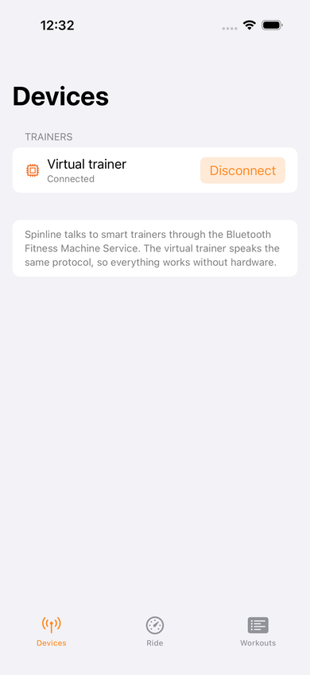
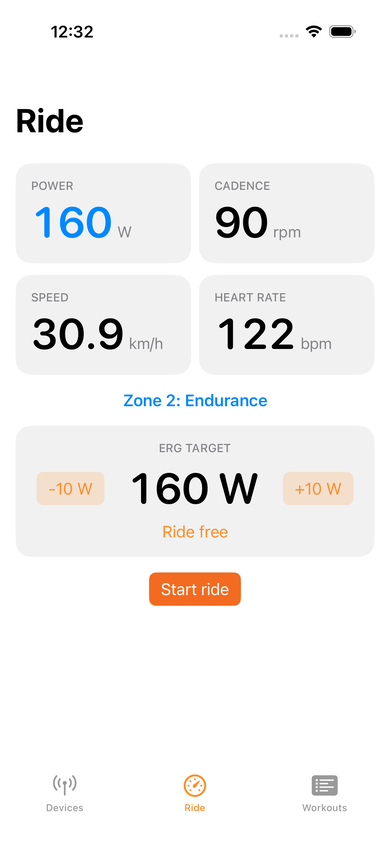
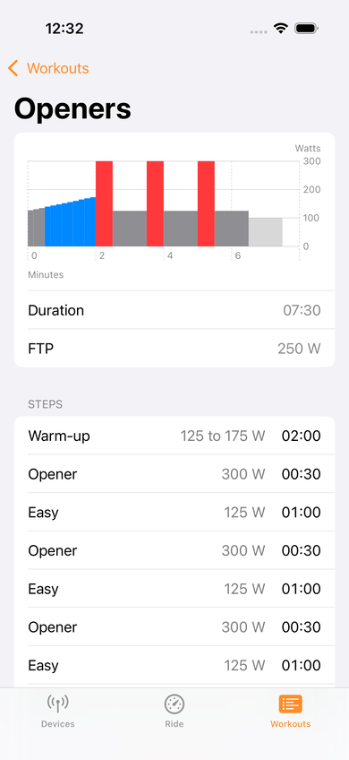
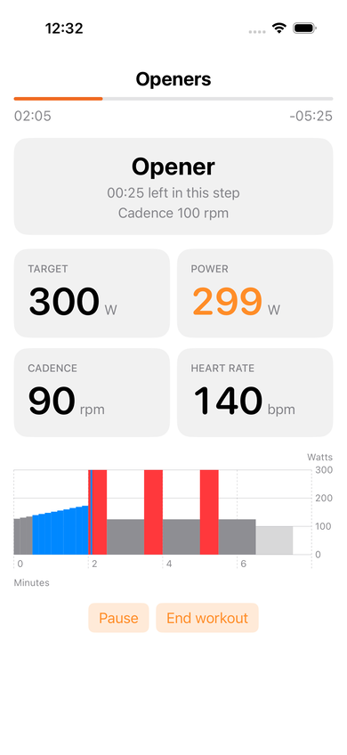
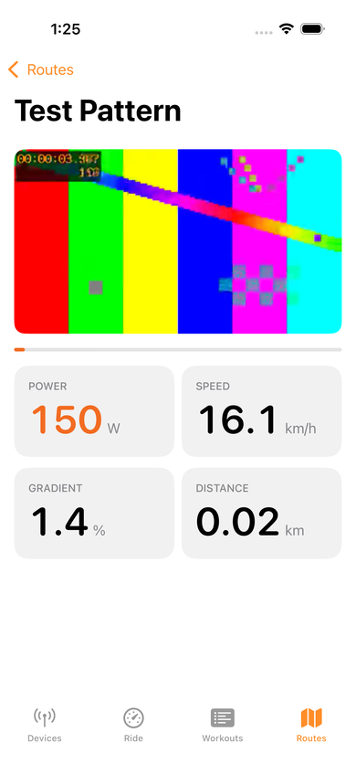
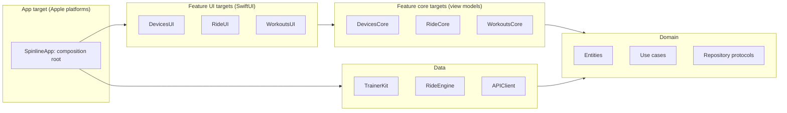

# Spinline

[](https://github.com/adam-bouafia/spinline/actions/workflows/ci.yml)

-lightgrey)
[](LICENSE)

Spinline is an indoor cycling app for smart trainers, written in Swift and SwiftUI. It connects to a trainer over Bluetooth, runs structured workouts in ERG mode, plays a route video whose speed follows the rider's effort, and lets several riders share a route.

Spinline is built on public Bluetooth SIG specifications (Fitness Machine Service, Heart Rate Service) and its own content. It is an independent personal project and is not affiliated with or endorsed by any trainer manufacturer or app maker.

<p align="center">
  
  
  
  
  
</p>
<p align="center">
  
</p>

The screenshots and the recording come from the iOS simulator in CI, with the app connected to the virtual trainer: the UI tests connect, set an ERG target, ride into the first interval of a workout and ride the test route, and a second step records a short session. Every push produces them again as build artifacts.

## Contents

- [Status](#status)
- [The app](#the-app)
- [Features](#features)
- [Architecture](#architecture)
- [Repository layout](#repository-layout)
- [Getting started](#getting-started)
- [Bluetooth protocol](#bluetooth-protocol)
- [Ride engine](#ride-engine)
- [Testing](#testing)
- [Continuous integration](#continuous-integration)
- [Branching and releases](#branching-and-releases)
- [Non-goals](#non-goals)
- [License](#license)

## Status

Early development. The protocol, physics and workout layers come first, because they are pure Swift and are tested on Linux and macOS on every push. The iOS app is built on top of them.

| Milestone | Scope | State |
|---|---|---|
| M0 | Repository, packages, toolchain, CI | done |
| M1 | TrainerKit: FTMS and heart-rate codecs | done |
| M2 | RideEngine: ride physics, workouts, video rate | done |
| M3 | Virtual trainer and a command-line ride | done |
| M4 | SwiftUI app built and tested in CI (iOS simulator) | done |
| M5 | CoreBluetooth adapter for real trainers | done (not yet tried on hardware) |
| M6 | Route video synced to the rider's speed | done (test-pattern route until a filmed one is added) |
| M7 | Backend from an OpenAPI spec, group ride | planned |
| M8 | Mac Catalyst, Jenkinsfile, release 0.1.0 | done; voice cues and ride export planned |

## The app

Three tabs and a session screen, all SwiftUI:

- **Devices** lists the virtual trainer and every Bluetooth trainer that advertises the Fitness Machine Service, and connects through the FTMS client.
- **Ride** shows power, cadence, speed and heart rate live, the current training zone, and ERG control: set a target in 10 W steps or ride free.
- **Workouts** lists the bundled workouts with a zone-coloured profile chart (Swift Charts) and the step list.
- **Routes** plays a route video whose speed follows the rider: the trainer's power drives the ride simulator over the route's gradient, `VideoSync` sets the playback rate four times a second, and the gradient goes to the trainer in simulation mode (when it changes by 0.5 % or more, at most once a second). The app ships a test-pattern route (FFmpeg test video, synthetic track) until a filmed route replaces it.
- **Session** runs a workout: progress, current step and time left, target against measured power, the chart with a marker for now, pause, resume and end. ERG targets go to the trainer as the steps change; free-ride steps release it.

Each screen has an `@Observable` view model in a core target that does not import SwiftUI. The view models are tested on Linux against the virtual trainer, and the SwiftUI views stay thin.

## Features

- **Devices.** Discover and connect a smart trainer that implements the Fitness Machine Service (FTMS) and a heart-rate strap. Live power, cadence, speed and heart rate.
- **Virtual trainer.** A software trainer that produces real FTMS packets and accepts control commands, so the app, the tests and CI run without hardware.
- **ERG and simulation.** Hold a target power whatever the cadence, or ride a gradient that the trainer turns into resistance.
- **Workouts.** Structured intervals with targets as a share of FTP, a timeline, and voice cues.
- **Route video.** A recorded ride whose playback rate follows the rider's virtual speed, computed from power, weight and the gradient of the route. The gradient is sent to the trainer.
- **Group ride.** Riders on the same route see each other on an elevation profile, over WebSockets.
- **Backend.** Routes, workouts and ride uploads behind an OpenAPI specification; client and server code are generated from the same file.
- **Export.** Rides saved as FIT files for upload to training platforms.
- **Mac.** The same app on macOS through Mac Catalyst (built in CI).

## Architecture

Clean Architecture with MVVM, split into feature modules. Each module is a local Swift package.



Rules that keep the layers honest:

- **Domain** holds entities (`TrainerSample`, `Workout`, `Route`), use cases and repository protocols such as `TrainerConnection`. It knows nothing about Bluetooth, SwiftUI or the network.
- **Data** implements the Domain protocols. `TrainerKit` speaks Bluetooth, `RideEngine` does physics and timing, `APIClient` talks to the backend.
- **Feature core** targets hold one `@Observable` view model per screen. They import Domain and Observation, never SwiftUI, so they build and test on Linux.
- **Feature UI** targets hold thin SwiftUI views: layout and bindings only.
- **The app target** is the composition root. It chooses the real or the virtual trainer and injects dependencies through initialisers.

## Repository layout

```
App/
  project.yml      XcodeGen spec: the iOS app target and its UI test target
  Sources/         SpinlineApp, AppModel (composition root), RootView
  UITests/         end-to-end UI test against the virtual trainer
Packages/
  Domain/          entities (TrainerSample, Workout, RiderProfile, PowerZone), TrainerConnection, TrainerDiscovery
  TrainerKit/      FTMS and heart-rate codecs, GATT transport protocol, FTMS client
  RideEngine/      ride physics, workout timeline and controller, ERG target pacing, video sync
  VirtualTrainer/  an FTMS trainer in software, with a virtual rider, and its discovery
  DesignSystem/    colours, typography, metric tile (SwiftUI)
  Features/
    Devices/       DevicesCore (view model) + DevicesUI (views)
    Ride/          RideCore + RideUI
    Workouts/      WorkoutsCore + WorkoutsUI (list, chart, session)
    Routes/        RoutesCore + RoutesUI (route video ride)
tools/
  dev.sh           build, test and lint wrapper used locally and in CI
  sim/             spinline-sim (ride a workout in the terminal) and route-index (GPX to route index)
  video/           prepare-route.sh (encode a filmed route and index it), make-test-route.sh
Content/
  Workouts/        workouts shipped with the app (JSON)
  Routes/          routes shipped with the app: <id>.mp4 and <id>.json
media/             README screenshots and recording
.github/
  workflows/       CI: Linux, macOS, iOS simulator
```

Every UI target wraps its sources in `#if canImport(SwiftUI)`, so the whole package graph builds on Linux and the UI compiles on Apple platforms. The `.xcodeproj` is generated, never committed. The server and the OpenAPI specification arrive in M7.

## Getting started

Requirements:

- Swift 6.0 or newer. Developed with Swift 6.3 on Linux and Xcode on macOS.
- For the iOS app: macOS with Xcode 16 or newer (iOS 17 SDK or newer) and [XcodeGen](https://github.com/yonaskolb/XcodeGen).

Clone and run the tests:

```bash
git clone https://github.com/adam-bouafia/spinline.git
cd spinline
tools/dev.sh test             # every package
tools/dev.sh test TrainerKit  # one package
tools/dev.sh lint             # swift format, strict
```

Ride a workout on the virtual trainer, through the real FTMS client:

```bash
tools/dev.sh run sim spinline-sim --workout Content/Workouts/openers.json --ftp 250
```

```
Openers: 07:30, FTP 250 W, virtual trainer
 time step            target   power  cadence     speed   HR
00:00 Warm-up          125 W    61 W   90 rpm  3.3 km/h   61
00:30 Warm-up          138 W   137 W   90 rpm 25.9 km/h  101
...
05:00 Opener           300 W   210 W   90 rpm 28.9 km/h  114
05:30 Easy             125 W   215 W   90 rpm 38.2 km/h  164
06:00 Easy             125 W   125 W   90 rpm 30.0 km/h  123
06:30 Spin              free   137 W   90 rpm 28.6 km/h  113
Workout complete: 07:30, 3.84 km, average 169 W, 30.7 km/h, max HR 167
```

The first second of each step shows the trainer catching up with the new target. Add `--speed 10` to ride at ten times real time instead of as fast as possible; `--help` lists all options.

Build and run the iOS app on macOS:

```bash
brew install xcodegen
xcodegen generate --spec App/project.yml
open App/Spinline.xcodeproj    # run the Spinline scheme on an iPhone simulator
```

The app connects to the virtual trainer from the Devices tab. Launch arguments for testing: `-uiTesting` connects at launch and runs time ten times faster; `-demoWorkout <id>` also starts that workout.

Each package also works with plain SwiftPM:

```bash
swift test --package-path Packages/TrainerKit
```

`tools/dev.sh` picks a known toolchain and, on Linux workstations, runs builds in a memory-capped systemd scope at low priority. Set `SPINLINE_TOOLCHAIN` to use another toolchain; run `tools/dev.sh` without arguments for all options.

## Bluetooth protocol

Spinline talks to trainers through the Fitness Machine Service as defined in the Bluetooth SIG specification FTMS v1.0 and the GATT Specification Supplement.

| Service or characteristic | UUID | Use |
|---|---|---|
| Fitness Machine Service | `0x1826` | trainer discovery |
| Fitness Machine Feature | `0x2ACC` | read: what the trainer measures and accepts |
| Indoor Bike Data | `0x2AD2` | notify: speed, cadence, power, about once a second |
| Supported Power Range | `0x2AD8` | read: ERG limits |
| Fitness Machine Control Point | `0x2AD9` | write and indicate: request control, target power, simulation |
| Fitness Machine Status | `0x2ADA` | notify: changes made by the trainer or the rider |
| Heart Rate Service | `0x180D` | heart-rate straps |
| Heart Rate Measurement | `0x2A37` | notify: heart rate and RR intervals |

All values are little-endian. Indoor Bike Data starts with a 16-bit flags field; each set flag adds a field in a fixed order. The codecs are pure functions over byte arrays and are tested against byte fixtures, so the protocol is verified without a radio.

TrainerKit implements:

| Type | Characteristic | Direction |
|---|---|---|
| `IndoorBikeData` | Indoor Bike Data | decode and encode, all 13 fields |
| `ControlPointCommand` | Fitness Machine Control Point | encode (client) and decode (virtual trainer) |
| `ControlPointResponse` | Fitness Machine Control Point | decode and encode |
| `FitnessMachineFeature` | Fitness Machine Feature | decode and encode |
| `FitnessMachineStatus` | Fitness Machine Status | decode and encode |
| `SupportedPowerRange` | Supported Power Range | decode and encode, nearest valid ERG target |
| `HeartRateMeasurement` | Heart Rate Measurement | decode and encode, 8 and 16-bit values, RR intervals |

Points where the specifications disagree, and what the code does:

- **Resistance Level in Indoor Bike Data.** FTMS v1.0 refers to a 2-byte `sint16`; the GATT Specification Supplement of 2026 lists a 1-byte `uint8`. All other fields have fixed sizes, so the packet length tells the two apart, and the decoder accepts both.
- **Instantaneous Cadence flag.** Table 4.10 of FTMS v1.0 prints bit 2 inverted; the GATT Specification Supplement says bit 2 set means cadence is present, which is what the code follows.
- **Padding.** Bytes after the last announced field are ignored, because some implementations append them. Control point writes, decoded by the virtual trainer, are strict: a wrong parameter size is an error.

Decoders never crash on bad input: a test feeds every decoder 20,000 random packets from a seeded generator.

### Client and virtual trainer

`GATTTransport` is the boundary between the protocol and the radio: values (notifications and indications), read, write with response, and subscribe. `FTMSTrainer` is the FTMS client on top of it and implements the Domain's `TrainerConnection`:

- on connect it reads the feature and power range, subscribes to Indoor Bike Data, Fitness Machine Status and control point indications, then requests control;
- it runs one control point procedure at a time (actors are reentrant, so commands go through an explicit queue), waits for the indication that answers each write, and times out;
- after Control Permission Lost, or a Control Not Permitted answer, it requests control again;
- ERG targets are clamped to the trainer's supported power range, and commands the trainer does not support are refused before anything is written.

`CoreBluetoothTransport` implements `GATTTransport` over a `CBPeripheral`: all state lives on one dispatch queue, and each delegate callback resumes the waiting read, write or subscription, or yields a notification. `BluetoothTrainerDiscovery` scans for service `0x1826`, connects, discovers the characteristics and hands the transport to `FTMSTrainer`. It compiles and its UUID mapping is tested on macOS in CI; it has not yet been run against a physical trainer, because none was available. The heart-rate strap codec exists, its Bluetooth wiring does not yet.

`VirtualTrainer` implements `GATTTransport` in memory as an FTMS server with a virtual rider: power follows the ERG target with a lag, speed comes from the ride simulator on the simulated gradient, heart rate drifts with effort. It answers malformed writes, unknown op codes, missing control and missing subscriptions the way the specification requires. The CoreBluetooth transport implements the same protocol, so the client code is identical for both.

## Ride engine

`RideEngine` is pure Swift and has no knowledge of Bluetooth or the screen.

**Physics.** Pedal power moves rider and bike against rolling resistance, gravity and air drag:

```
P * efficiency = v * (m * g * (Crr * cos(a) + sin(a)) + 0.5 * rho * CdA * v^2)
```

`CyclingPhysics.steadySpeed(power:grade:)` solves it for speed by bisection; with the defaults (83 kg, Crr 0.004, CdA 0.32 m^2, efficiency 0.97) 200 W on the flat holds 33.9 km/h. `RideSimulator` adds inertia by integrating kinetic energy, which stays stable at zero speed, stops on a climb without rolling back, and starts rolling on a descent steeper than the rolling resistance.

**Workouts.** A `Workout` is a list of steps with targets as fractions of FTP (steady, ramp or free ride), read from JSON with `repeat` blocks for intervals. `WorkoutPlan` resolves it for a rider into a timeline with the target in watts at any second. `ErgTargetTracker` decides when a new ERG target goes to the trainer: only on a change, at most once a second, never dropping a step change.

**Routes from GPS.** `RouteBuilder` turns the GPX track recorded while filming into a `RouteIndex`: cumulative haversine distance, one point per video second, and a gradient measured over 40 m because GPS elevation is noisy. `tools/video/prepare-route.sh` re-encodes the video with a keyframe every second (smooth seeks and rate changes) and runs `route-index`.

**Video sync.** `RouteIndex` maps each second of a route video to the distance along the route and the gradient. `VideoSync` turns the rider's virtual distance and speed into a player command every tick:

- base rate = rider speed / camera speed at that point (clamped to 0.1x - 2x);
- plus a correction of `drift / 2 s` so the frame on screen converges to the rider's position;
- a seek when the drift exceeds 5 s, a pause below walking pace, and stops in the recording are skipped.

## Testing

- Swift Testing (`@Test`, `#expect`, parameterised arguments) in every package.
- Codecs are tested with byte fixtures worked out by hand from the specification tables, encode-decode round trips, and malformed packets that must throw.
- Random packets from a seeded generator check that no decoder can crash on radio input.
- Physics values are pinned to an independent reference computation; properties such as "more power is always faster" and "power and speed are inverses" are checked across ranges.
- Video sync is checked in closed loop: a simulated player that follows the commands converges to the rider's position.
- The FTMS client is tested against the virtual trainer: ERG convergence, simulated climbs, lost control (announced and silent), concurrent commands, clamping, dropped links and timeouts.
- View models are tested on Linux against the virtual trainer: ERG control, refused commands, zones, workout sessions step by step, pause, a lost trainer, a full session at 200 times real time.
- One XCUITest drives the app on an iOS simulator in CI: connect, ERG, open a workout, ride into the first interval. It attaches a screenshot of each screen.

## Continuous integration

GitHub Actions runs on every push to `develop` and `main` and on every pull request:

| Job | Runner | Steps |
|---|---|---|
| Linux | `swift:6.3-noble` container | `swift format lint --strict`, test every package, ride a workout with `spinline-sim` |
| macOS | `macos-15` with Xcode | test every package (the SwiftUI targets compile here), ride a workout with `spinline-sim` |
| iOS app | `macos-15`, iOS simulator | `xcodegen generate`, `xcodebuild test` with the UI tests, export screenshots, record a demo video; all uploaded as artifacts |
| Mac Catalyst | `macos-15` | build the same app target for Mac |

The `Jenkinsfile` runs the Linux stages (lint, test, sim ride) in the same `swift:6.3-noble` image, for teams on Jenkins; the Apple stages need a macOS agent with Xcode.

## Branching and releases

The repository follows GitFlow:

- `develop` is the default branch and always builds.
- Work happens on `feature/*` branches and reaches `develop` through pull requests with green CI.
- Releases are cut on `release/x.y.z`, merged into `main` and tagged `vx.y.z`.
- Urgent fixes go on `hotfix/*` from `main`.

Commit messages follow [Conventional Commits](https://www.conventionalcommits.org/). Changes per release are in [CHANGELOG.md](CHANGELOG.md).

## Non-goals

- App Store distribution, accounts and payments.
- ANT+, which iOS devices do not support without extra hardware.
- Proprietary trainer protocols or content from other apps.
- 3D rendering. Rides use recorded video.

## License

[MIT](LICENSE)
